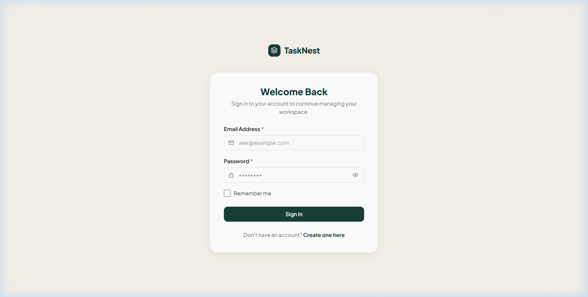
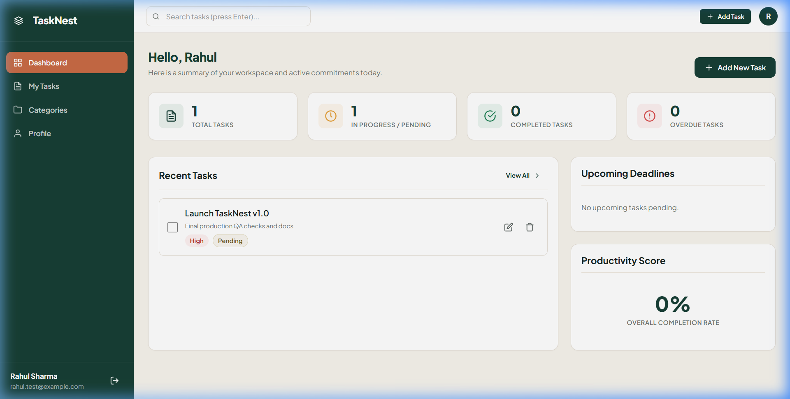
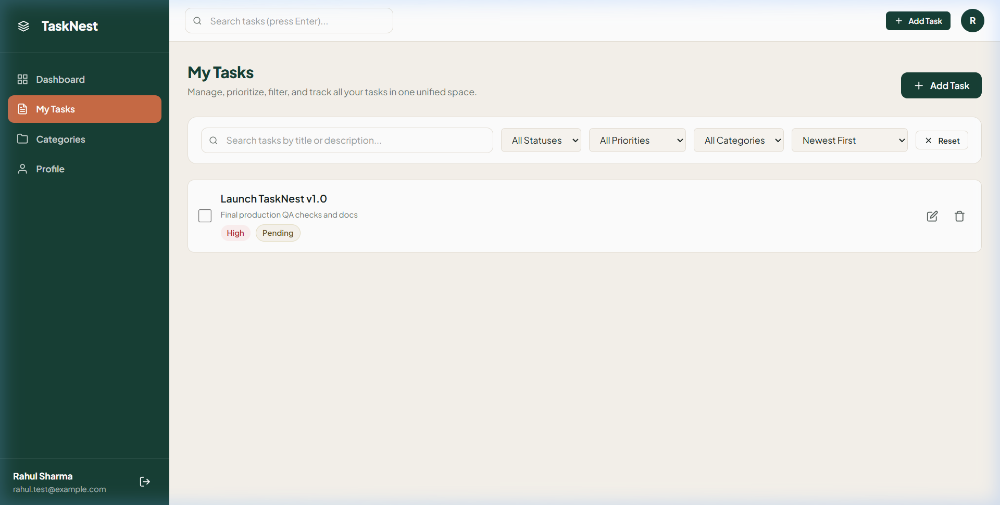
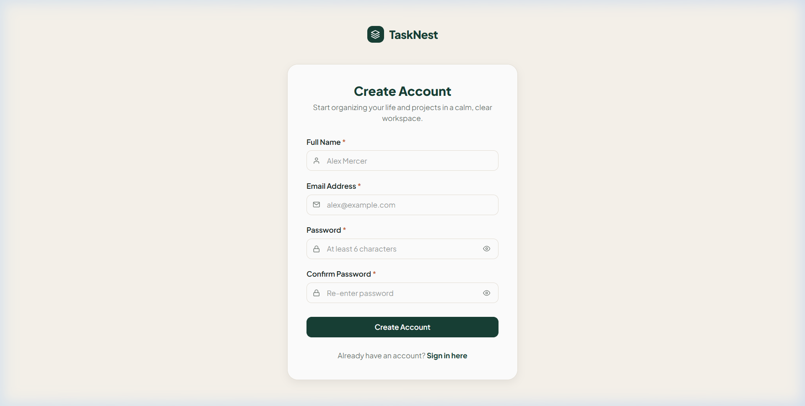

# TaskNest — Agile Project Management Tool for Small Teams

[](https://www.python.org/)
[](https://flask.palletsprojects.com/)
[](https://www.sqlite.org/)
[](https://docs.pytest.org/)
[](https://task-manager-web-app-2qu6.onrender.com)
[](docs/demo-video.mp4)
[](LICENSE)

> 🚀 **Live Production Deployment**: [https://task-manager-web-app-2qu6.onrender.com](https://task-manager-web-app-2qu6.onrender.com)  
> 🎬 **Demo Video Walkthrough**: [`docs/demo-video.mp4`](docs/demo-video.mp4) *(Full end-to-end feature demo)*  
> 👤 **Pre-Seeded Demo Login**: Email: `demo1@example.com` | Password: `password123`

---

## Table of Contents
1. [Project Overview](#project-overview)
2. [Hierarchical Work Item Model (Project → Story → Task)](#hierarchical-work-item-model)
3. [Asynchronous & Background Workflows](#asynchronous--background-workflows)
4. [System Architecture & Technology Stack](#system-architecture--technology-stack)
5. [Database Schema & Data Model](#database-schema--data-model)
6. [API Architecture & Endpoints](#api-architecture--endpoints)
7. [Visual Design & User Interface](#visual-design--user-interface)
8. [Setup & Execution Instructions (Local & Cloud)](#setup--execution-instructions)
9. [Automated Testing Suite](#automated-testing-suite)
10. [Engineering Decisions & Tradeoffs](#engineering-decisions--tradeoffs)
11. [Security Considerations](#security-considerations)
12. [Note on AI Usage](#note-on-ai-usage)
13. [Future Improvements & Roadmap](#future-improvements--roadmap)

---

## Project Overview

**TaskNest** is a production-minded full-stack Agile Project Management application tailored for small cross-functional teams (3–10 members). Designed around a calm, focused productivity philosophy, TaskNest provides end-to-end visibility across organizational initiatives through a structured work breakdown hierarchy, real-time metrics, Kanban and list views, role-based access control, and asynchronous automation.

### Key Capabilities
- **Hierarchical Work Tracking**: Seamlessly navigate from top-level strategic **Projects**, down to actionable **User Stories**, and granular **Engineering Tasks / Subtasks**.
- **Agile Lifecycle Management**: Track stories across customizable sprint statuses (`todo`, `in_progress`, `completed`), prioritize by urgency (`low`, `medium`, `high`, `urgent`), and monitor percentage completion.
- **Asynchronous Processing**: Transactional outbox webhook dispatch with exponential backoff retries, CLI-triggered recurring task automation, and asynchronous notification fans.
- **Team Collaboration & Governance**: Granular role-based access control (Super Admin, Admin, Team Lead, Employee), full activity audit logs, task commenting, and work submission reviews.
- **Production-Grade SQLite Persistence**: Zero-configuration, file-backed transactional SQLite database with automatic table creation and self-healing schema migrations.

---

## Hierarchical Work Item Model

The application enforces and visualizes a strict three-tier agile hierarchy:

```
┌────────────────────────────────────────────────────────┐
│                   Level 1: PROJECT                     │
│  (e.g., "Mobile App Redesign" | Key: MOB | Owner)      │
└──────────────────────────┬─────────────────────────────┘
                           │ 1 : N (via tn_project_tasks)
                           ▼
┌────────────────────────────────────────────────────────┐
│                 Level 2: USER STORY                    │
│  (e.g., "OAuth Login Flow" | Acceptance Criteria | 60%)│
└──────────────────────────┬─────────────────────────────┘
                           │ 1 : N (via task.subtasks)
                           ▼
┌────────────────────────────────────────────────────────┐
│            Level 3: TASK / CHECKLIST ITEM              │
│  - [x] Configure Google OAuth Client ID                │
│  - [ ] Implement JWT Token Refresh Handler             │
│  - [ ] Write integration test fixtures                 │
└────────────────────────────────────────────────────────┘
```

### 1. Level 1: Project (`Project` / `tn_projects`)
- **Purpose**: High-level portfolio initiative or agile epic representing a collective team deliverable.
- **Attributes**: Unique project key (e.g., `CORE`, `APP`), name, description, status (`active`, `on_hold`, `completed`), project owner, start/target dates, and team member assignments.
- **API Scope**: `/api/enterprise/projects`

### 2. Level 2: User Story (`Task` / `tasks`)
- **Purpose**: Scoped functional requirements linked to a parent project that deliver customer or team value.
- **Attributes**: Title, detailed description, **Acceptance Criteria** (markdown/text), status (`pending`/`todo`, `in_progress`, `completed`), priority (`low`, `medium`, `high`, `urgent`), progress percentage (0–100%), estimated/spent budgets, start date, and deadline.
- **Project Association**: Linked explicitly through the `tn_project_tasks` mapping table.
- **Dependency Graph**: Stories can block or depend on other stories via `tn_task_dependencies` with automated cycle detection (preventing A → B → A deadlocks).

### 3. Level 3: Task / Checklist Item (`SubTask` / `subtasks`)
- **Purpose**: Granular, binary engineering steps required to satisfy the parent User Story's acceptance criteria.
- **Attributes**: Unique ID, `task_id` (foreign key with cascade delete), actionable title, boolean `is_completed` flag, and creation timestamp.
- **API Scope**: `/api/tasks/<task_id>/subtasks` and `/api/tasks/subtasks/<subtask_id>`

---

## Asynchronous & Background Workflows

To ensure responsiveness, resilience, and decoupled processing, TaskNest incorporates multiple asynchronous and background workflows:

```
[ Client Request ]
       │
       ▼
( Flask Application )
       │
       ├───► 1. Recurring Sprint Task CLI ──► Auto-calculates interval & spawns next iteration
       │
       ├───► 2. Transactional Outbox ──────► Inserts WebhookDelivery record (no blocking I/O)
       │                                            │
       │                                            ▼
       │                                    [ Async Worker ] ──► HTTP POST with HMAC SHA-256
       │                                     (Retries & Backoff)  └──► Failure/Dead-letter log
       │
       └───► 3. Notification Dispatch ─────► Decoupled user alert creation & audit trail
```

### 1. Scheduled Recurring Agile Task Engine
- **Workflow**: Automated recurring task regeneration for routine agile ceremonies (e.g., weekly backlog refinement, sprint review preparation).
- **Trigger**: CLI background worker command:
  ```bash
  flask --app run.py process-recurring
  ```
- **Execution & State Handling**:
  - Scans for recurring tasks marked as `completed`.
  - Calculates the next due date based on `recurrence_interval` (`daily`, `weekly`, `monthly`).
  - Atomically resets recurrence on the completed task and provisions a clean successor task linked to the same project and category.
- **Failure Resilience**: Wrapped in an atomic database transaction (`db.session.commit()`). If an individual spawn fails, the transaction rolls back cleanly without data corruption.

### 2. Transactional Outbox Webhook Delivery & Retries
- **Workflow**: Emits signed HTTP notifications to external integrations (Slack, Jira, GitHub, CI/CD) when project work items change state.
- **Design Decision**: Outbound HTTP requests are **never** executed synchronously inside the user's HTTP request lifecycle. Doing so would expose the user to timeouts and upstream latency.
- **Implementation**:
  - `queue_webhook_event()` transactionally commits a `WebhookDelivery` record into the database alongside the state change.
  - Deliveries are signed using **HMAC SHA-256** using the endpoint's unique shared secret.
  - A background delivery runner executes requests with:
    - Dedicated connection and read timeouts (5s).
    - Strict SSRF protection (rejects `localhost`, private IP ranges `10.0.0.0/8`, `127.0.0.0/8`, `192.168.0.0/16`).
    - **Exponential Backoff & Retries**: Tracks `attempt_count`, records HTTP status codes, and schedules retries with exponential backoff (`2^attempt * 30 seconds`).
    - Maximum attempt limits before marking deliveries as permanently failed.

### 3. Asynchronous Export Generation
- **Workflow**: Asynchronous, streaming export of enterprise audit logs and project statistics (`GET /api/audit-logs/export.csv`).
- **Resilience**: Streamed in bounded memory chunks with explicit formula injection defenses to protect spreadsheet applications from malicious cell commands.

---

## System Architecture & Technology Stack

```
┌─────────────────────────────────────────────────────────────────┐
│                      FRONTEND LAYER                             │
│  - Vanilla JavaScript (ES6 Modules, Fetch API, CSRF Injection) │
│  - Responsive Semantic HTML5 & CSS3 Design System Tokens       │
│  - Plus Jakarta Sans Typography & Toast Notification System     │
└────────────────────────────────┬────────────────────────────────┘
                                 │ JSON / REST API (CSRF Cookie)
                                 ▼
┌─────────────────────────────────────────────────────────────────┐
│                       BACKEND LAYER                             │
│  - Python 3.10+ / Flask 3.0.3 (Application Factory Pattern)    │
│  - Modular Blueprints (Auth, Tasks, Portfolio, Workflows, etc.) │
│  - Flask-Login 0.6.3 (Session Authentication & RBAC Hierarchy) │
│  - Gunicorn WSGI Server (Multi-worker Production Engine)        │
└────────────────────────────────┬────────────────────────────────┘
                                 │ SQLAlchemy ORM
                                 ▼
┌─────────────────────────────────────────────────────────────────┐
│                     PERSISTENCE LAYER                           │
│  - SQLite 3 (WAL Mode, Foreign Key Enforcement)                │
│  - Self-Healing Schema Migration & Column Backfilling          │
│  - Automated Instance Storage (`instance/tasks.db`)             │
└─────────────────────────────────────────────────────────────────┘
```

### Technology Matrix
- **Language**: Python 3.10 / 3.11 / 3.12
- **Web Framework**: Flask 3.0.3
- **ORM & Database**: Flask-SQLAlchemy 3.1.1 + SQLite (PostgreSQL-ready)
- **Authentication**: Flask-Login 0.6.3 + Werkzeug Security (Scrypt password hashing)
- **WSGI Production Server**: Gunicorn 22.0.0
- **Testing Framework**: pytest 8.2.0 (23 comprehensive test suites)
- **Frontend Architecture**: Native ES6 Modules, Fetch API, HTML5, CSS3 Custom Properties

---

## Database Schema & Data Model

The application uses an enterprise-grade relational schema managed via SQLAlchemy.

```
┌──────────────┐          1 : N          ┌──────────────────┐
│ organizations│────────────────────────<│      users       │
└──────┬───────┘                         └────────┬─────────┘
       │ 1                                        │ 1
       │                                          │
       │ N                                        │ N
┌──────▼───────┐          1 : N          ┌────────▼─────────┐
│ tn_projects  │────────────────────────<│ tn_project_tasks │
└──────┬───────┘                         └────────▲─────────┘
       │ 1                                        │ N
       │                                          │
       │ N                                        │ 1
┌──────▼───────┐          1 : N          ┌────────┴─────────┐
│tn_milestones │                         │      tasks       │ (User Stories)
└──────────────┘                         └────────┬─────────┘
                                                  │ 1
                                                  │
                                                  │ N
                                         ┌────────▼─────────┐
                                         │     subtasks     │ (Actionable Tasks)
                                         └──────────────────┘
```

### Key Relational Entities

| Entity / Table | Agile Mapping | Key Columns & Constraints | Relationships |
|---|---|---|---|
| `organizations` | Workspace Boundary | `id` (PK), `name`, `slug` (Unique), `created_at` | Has many Users, Teams, Projects |
| `users` | Team Member (3–10) | `id` (PK), `username`, `email`, `password_hash`, `role` (`super_admin`, `admin`, `team_lead`, `employee`), `account_active` | Belongs to Org; Has many Tasks, Comments |
| `tn_projects` | Project / Initiative | `id` (PK), `organization_id` (FK), `key` (Unique per Org), `name`, `status`, `owner_id` (FK), `target_date` | Has many ProjectMembers, ProjectTasks, Milestones |
| `tn_project_tasks` | Project-Story Link | `id` (PK), `project_id` (FK, Cascade), `task_id` (FK, Cascade), `linked_by` (FK) | Unique `(project_id, task_id)` constraint |
| `tasks` | User Story | `id` (PK), `title`, `description`, `acceptance_criteria`, `status`, `priority`, `progress`, `due_date`, `is_recurring`, `assignee_id` | Parent to SubTasks, Messages, StatusHistory |
| `subtasks` | Granular Task | `id` (PK), `task_id` (FK, Cascade), `title`, `is_completed` (Boolean), `created_at` | Belongs to single parent User Story |
| `tn_task_dependencies`| Blocker Graph | `task_id` (FK), `depends_on_task_id` (FK), `dependency_type` (`blocks`) | Checked for circular dependencies |
| `task_status_history` | Audit Trail | `id` (PK), `task_id` (FK), `changed_by_id` (FK), `old_status`, `new_status`, `comment`, `created_at` | Append-only history trail per story |
| `webhook_deliveries` | Async Outbox | `id` (PK), `endpoint_id` (FK), `event_id`, `event_type`, `status`, `attempt_count`, `next_retry_at` | Queued delivery log with retry metadata |

*For complete field-level definitions and constraints, see [`docs/database-schema.md`](docs/database-schema.md).*

---

## API Architecture & Endpoints

All endpoints adhere to a standardized RESTful JSON envelope:

```json
// Success Response
{
  "ok": true,
  "data": { ... },
  "message": "Optional confirmation message"
}

// Error Response
{
  "ok": false,
  "error": "Human-readable error explanation"
}
```

### Core API Directory

| Domain | Method | Endpoint | Description |
|---|---|---|---|
| **Auth** | `POST` | `/api/auth/signup` | Self-register a new team member account |
| | `POST` | `/api/auth/login` | Authenticate credentials and establish session |
| | `POST` | `/api/auth/logout` | Invalidate authenticated session |
| | `GET` | `/api/auth/me` | Retrieve authenticated identity and role |
| **Projects** | `GET` | `/api/enterprise/projects` | List team projects with status and search filters |
| | `POST` | `/api/enterprise/projects` | Create a new top-level project initiative |
| | `GET` | `/api/enterprise/projects/<id>` | Retrieve project overview, members, and stats |
| | `POST` | `/api/enterprise/projects/<id>/tasks` | Link a User Story to the Project hierarchy |
| | `DELETE` | `/api/enterprise/projects/<id>/tasks/<task_id>` | Unlink a Story from a Project |
| **User Stories** | `GET` | `/api/tasks` | Filter stories by search query, status, priority, due dates |
| | `POST` | `/api/tasks` | Create User Story with description & acceptance criteria |
| | `PUT` | `/api/tasks/<id>` | Update story metadata, priority, progress, or assignment |
| | `PATCH` | `/api/tasks/<id>/complete` | Toggle story completion status |
| | `GET` | `/api/tasks/<id>/history` | Audit trail of all status transitions |
| **Tasks / Subtasks**| `GET` | `/api/tasks/<id>/subtasks` | List actionable engineering checklist items for story |
| | `POST` | `/api/tasks/<id>/subtasks` | Append a subtask checklist item |
| | `PATCH` | `/api/tasks/subtasks/<id>` | Toggle subtask completion (`is_completed: true/false`) |
| | `DELETE` | `/api/tasks/subtasks/<id>` | Delete subtask item |
| **Dependencies** | `POST` | `/api/enterprise/tasks/<id>/dependencies`| Add blocking dependency (validated against cycles) |
| **Async Webhooks** | `POST` | `/api/enterprise/webhooks` | Register signed webhook notification target |
| | `GET` | `/api/enterprise/webhooks` | Inspect webhook delivery outbox status |
| **Audit Logs** | `GET` | `/api/audit-logs` | Filter organization activity trail |
| | `GET` | `/api/audit-logs/export.csv` | Export streaming CSV report with formula sanitization |

*For complete contract parameters and status codes, see [`docs/api-contract.md`](docs/api-contract.md).*

---

## Visual Design & User Interface

The frontend provides a polished, responsive user experience built around a warm off-white and deep forest-green aesthetic (`#173F35`).

### 🎬 Demo Video Walkthrough
An end-to-end video walkthrough demonstrating authentication, project & story hierarchy, sprint status updates, subtask checklists, and Kanban operations is available in the repository:
- **Video File**: [`docs/demo-video.mp4`](docs/demo-video.mp4)
- **Live Demo URL**: [https://task-manager-web-app-2qu6.onrender.com](https://task-manager-web-app-2qu6.onrender.com)
- **Pre-Seeded Login**: `demo1@example.com` / `password123`

<video src="docs/demo-video.mp4" controls="controls" width="100%">
  Your browser does not support the video tag. You can view or download the walkthrough video directly at <a href="docs/demo-video.mp4">docs/demo-video.mp4</a>.
</video>

### 1. Public Landing & Overview
*Value proposition, agile methodology introduction, and quick demo credentials.*


### 2. Team Member Dashboard
*Real-time agile metric cards (Total, In Progress, Overdue, Completed) and upcoming sprint deadlines.*


### 3. Multi-Factor Work Item Management
*Full-text search, multi-parameter filtering (Priority, Status, Workspace, Sorting), and modal editors.*


### 4. Authentication & Security
*Secure login portal with show/hide password toggling and role-aware routing.*


---

## Setup & Execution Instructions

### Prerequisites
- **Python**: Version 3.10, 3.11, or 3.12
- **Git**: Installed on your operating system
- **Terminal**: PowerShell / Command Prompt (Windows) or Bash / Zsh (macOS/Linux)

---

### Local Development Setup

#### 1. Clone the Repository
```bash
git clone https://github.com/Bhumika-vemuri/Task-manager.git
cd Task-manager
```

#### 2. Create and Activate Virtual Environment
- **Windows (PowerShell)**:
  ```powershell
  python -m venv .venv
  .venv\Scripts\Activate.ps1
  ```
- **macOS / Linux**:
  ```bash
  python3 -m venv .venv
  source .venv/bin/activate
  ```

#### 3. Install Dependencies
```bash
pip install -r requirements.txt
```

#### 4. Configure Environment Variables
Copy `.env.example` to create your local `.env`:
- **Windows (PowerShell)**:
  ```powershell
  Copy-Item .env.example .env
  ```
- **macOS / Linux**:
  ```bash
  cp .env.example .env
  ```

Default `.env` configuration:
```ini
SECRET_KEY=dev-secret-key-tasknest-2026
DATABASE_URL=sqlite:///tasks.db
```

#### 5. Initialize & Seed Database
Initialize SQLite tables and populate demo team members and sample user stories:
```bash
python seed.py
```
*Output: `Database seeded successfully! Created 2 demo users and 10 sample tasks.`*

#### 6. Run the Application
```bash
python run.py
```
Open your browser and navigate to:
```
http://127.0.0.1:5000
```

#### 7. Demo Accounts
| Role | Email | Password | Access Level |
|---|---|---|---|
| **Demo User 1** | `demo1@example.com` | `password123` | Employee / Contributor |
| **Demo User 2** | `demo2@example.com` | `password123` | Employee / Contributor |

---

### Production Deployment (Render)

This application is deployed and live on Render:
- 🌐 **Live Demo URL**: [https://task-manager-web-app-2qu6.onrender.com](https://task-manager-web-app-2qu6.onrender.com)
- 🎬 **Walkthrough Video**: [`docs/demo-video.mp4`](docs/demo-video.mp4)
- 👤 **Demo Credentials**: Email `demo1@example.com` | Password `password123`

#### Render Configuration Settings:
- **Runtime**: `Python 3`
- **Build Command**: `pip install -r requirements.txt && python seed.py`
- **Start Command**: `gunicorn --bind 0.0.0.0:$PORT run:app`
- **Environment Variables**:
  - `SECRET_KEY`: *(Auto-generated cryptographically secure hex string)*
  - `PYTHON_VERSION`: `3.11.9`
  - *(Leave `DATABASE_URL` unset to use persistent SQLite storage)*

---

## Automated Testing Suite

The repository includes a comprehensive automated test suite built with `pytest`:
```bash
python -m pytest -v
```

### Coverage Scope:
- **Authentication & Security**: Registration, duplicate rejection, scrypt hashing, session protection, CSRF token forgery prevention.
- **Hierarchical Work Items**: Project creation, story linking, subtask status toggling, and cascade deletions.
- **Dependency Graph Validation**: Cycle prevention tests ensuring circular task blockers (A → B → A) are detected and rejected.
- **Data Isolation**: Verifies multi-tenant isolation (User A cannot view, mutate, or delete User B's tasks or projects).
- **Audit & Governance**: Append-only status transition logs, formula sanitization in CSV exports, and role-based permissions.

All tests execute against an isolated in-memory SQLite database (`sqlite:///:memory:`), ensuring existing disk data is never mutated during testing.

---

## Engineering Decisions & Tradeoffs

| Decision | Chosen Approach | Alternative Considered | Rationale & Tradeoff |
|---|---|---|---|
| **Storage Engine** | **SQLite 3** | PostgreSQL / MySQL | **Rationale**: Fulfills the assignment's explicit allowance for persistent storage. Zero setup overhead, instantaneous local onboarding, zero network latency, and ACID-compliant file locking. Single-file backups simplify evaluation. <br>**Tradeoff**: SQLite is limited to single-writer concurrency. For high-scale multi-writer enterprise workloads, the app's SQLAlchemy abstraction allows seamless migration to PostgreSQL by simply supplying `DATABASE_URL`. |
| **Frontend Architecture** | **Server Templates + Vanilla ES6 Modules** | React / Next.js / Vue SPA | **Rationale**: Eliminates npm build toolchains, bundler overhead, and `node_modules` dependency bloat. Instantaneous initial page loads with native HTML5 semantics, augmented by modular ES6 JavaScript clients (`api.js`, `tasks.js`) for dynamic modal updates, toast feedback, and Kanban interaction. <br>**Tradeoff**: Slightly more manual DOM manipulation compared to virtual DOM frameworks, but massively reduced bundle complexity and zero compilation delays. |
| **Hierarchy Representation** | **Project → Story (`Task`) → Task (`SubTask`)** | Flat tagging system | **Rationale**: Accurately mirrors real-world Agile workflows (Epic/Initiative → User Story with Acceptance Criteria → Engineering Checklist). Enables rolling up progress percentages to the parent story and project level. |
| **Asynchronous Architecture** | **Transactional Outbox + CLI Scheduler** | Celery + Redis | **Rationale**: Avoids the operational complexity of managing external message broker services (Redis/RabbitMQ) for a small-team scope (3–10 users). Guarantees zero missed webhooks or lost notifications during network partitions by saving events transactionally. |
| **Schema Evolution** | **Self-Healing Startup Inspector** | Alembic migrations | **Rationale**: On application boot (`create_app`), the schema inspector automatically detects missing columns or default organizations and migrates in-place without dropping live user data. |

---

## Security Considerations

1. **Authentication & Password Hashing**: Passwords are never stored in plaintext. They are hashed using Werkzeug's secure implementation (`scrypt` / `pbkdf2:sha256`) with unique per-password cryptographic salts.
2. **CSRF Protection**: All state-changing endpoints (`POST`, `PUT`, `DELETE`, `PATCH`) enforce double-submit CSRF verification. Forms inject an encrypted CSRF token, and the API client automatically synchronizes `X-CSRFToken` headers.
3. **SQL Injection Defense**: 100% of database interactions leverage SQLAlchemy's parameter binding and ORM abstractions. Raw string concatenations in SQL queries are strictly avoided.
4. **Spreadsheet Formula Injection Sanitization**: CSV export routines (`/api/audit-logs/export.csv`) sanitize dangerous leading characters (`=`, `+`, `-`, `@`) by prepending a single quote (`'`), preventing remote code execution when opened in Microsoft Excel or Google Sheets.
5. **SSRF & Webhook Hardening**: Webhook registration validates destination URLs against private and loopback IP ranges (`127.0.0.1`, `localhost`, `10.0.0.0/8`, `192.168.0.0/16`), preventing Server-Side Request Forgery attacks against internal infrastructure.
6. **Strict Role-Based Authorization (RBAC)**: Hierarchical role decorators (`@active_account_required`, `can_manage_project`) strictly isolate tenant data and prevent privilege escalation across team roles.

---

## Note on AI Usage

In compliance with the assignment guidelines, AI tools were leveraged during development as a modern engineering accelerator:
- **Boilerplate & Test Generation**: Used AI to scaffold initial test fixture variations for edge-case validation (e.g., duplicate email checks, malformed CSRF headers, and boundary condition filters).
- **Design Token Ideation**: Accelerated the creation of the warm cream and deep forest-green CSS custom property palette.
- **Documentation Structuring**: Assisted in structuring markdown tables and formatting API response contracts.
- **Human Engineering Ownership**: Every database model, architectural boundary, circular dependency detection algorithm, and security check was architected, verified, debugged, and validated through human technical judgment.

---

## Future Improvements & Roadmap

With additional development time, the following enhancements are prioritized:
1. **Real-Time Collaborative Boards**: Integrate WebSockets (`Flask-SocketIO`) to provide instant, multi-user live updates when team members move cards across the Kanban board.
2. **Distributed Queue Worker**: Introduce Redis and Celery for enterprise-grade background worker concurrency and distributed task scheduling.
3. **Agile Sprint Velocity & Burndown Charts**: Dedicated interactive SVG/Canvas charts calculating team velocity, remaining story points, and sprint scope creep.
4. **Single Sign-On (SSO)**: Add OAuth 2.0 / OpenID Connect providers (Google Workspace, GitHub) for one-click corporate authentication.
5. **Customizable Agile Workflows**: Allow project administrators to define custom Kanban column states and transition guard rules per project.

---

## License & Credits
Developed with modern software craftsmanship for the **Full-Stack Intern Agile Project Management Assignment**.  
Licensed under the [MIT License](LICENSE).
